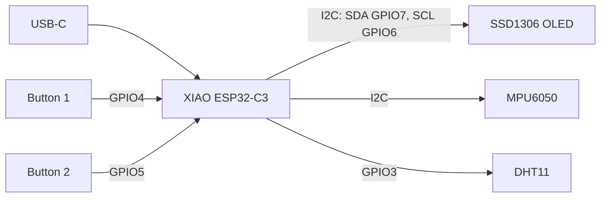

# Starbie: Bat Edition

A tiny desk pet on a custom-designed PCB. An animated pixel creature lives on a 128x64 OLED, reacts when you tilt or shake the board, and can be napped, played with, fed and petted through a tilt-controlled radial menu. A DHT11 sensor adds room temperature and humidity.

The board outline is bat-shaped, and the pet itself is a hand-made 32x32 bat sprite.

Built for [Half Life](https://halflife.hackclub.com) by Hack Club. See [JOURNAL.md](JOURNAL.md) for the build log and [BOM.md](BOM.md) for the parts list.

<p align="center">
  
</p>

<p align="center"><em>PCB layout in KiCad: bat-inspired outline, all parts placed inside it, custom name on the silkscreen.</em></p>

## Features

- 128x64 SSD1306 OLED showing a wandering pixel pet (custom bat sprite)
- Tilt-controlled radial menu with four actions: NAP, PLAY, FEED, PET
- Shake detection with its own reaction (MPU6050 accelerometer and gyro)
- Two buttons: one opens and confirms the menu, the other toggles a stats screen
- DHT11 temperature and humidity sensor
- Powered over USB-C through the XIAO ESP32-C3
- Custom bat-shaped board outline and silkscreen name

## How it works



The OLED and the MPU6050 share one I2C bus. The firmware reads the MPU6050 to detect tilt and shakes, draws the pet and the menu on the OLED, and reads the buttons and the DHT11 on plain GPIO pins.

## Hardware

### Bill of materials

| Ref | Part | Qty | Notes |
| --- | --- | --- | --- |
| U2 | Seeed Studio XIAO ESP32-C3 | 1 | SMD footprint from the Starbie care package |
| J1 | 0.96" SSD1306 I2C OLED module, 128x64 | 1 | 4-pin header, board silkscreen order is GND, VDD, SCL, SDA. Check your module's pin order before soldering |
| J2 | MPU6050 breakout (GY-521 style) | 1 | 8-pin header. Only VCC, GND, SCL and SDA are connected, pins 5 to 8 are left open |
| U1 | DHT11 temperature and humidity sensor | 1 | VDD, DATA and GND connected |
| R1 | 10 kOhm resistor | 1 | Pull-up between the DHT11 DATA line and 3.3 V |
| SW1, SW2 | Key switch (SW_Push footprint) | 2 | One side to a GPIO, the other side to GND |

### Pin map

| Function | XIAO pin | ESP32-C3 GPIO | Schematic net |
| --- | --- | --- | --- |
| OLED and MPU6050 SDA | D5 | GPIO7 | SDA |
| OLED and MPU6050 SCL | D4 | GPIO6 | SCL |
| DHT11 DATA | D1 | GPIO3 | DHT11 DATA |
| Button 1 (SW1) | D2 | GPIO4 | GP102 |
| Button 2 (SW2) | D3 | GPIO5 | GP103 |

- Power: the XIAO's 3V3_OUT feeds the +3.3 V rail (OLED, MPU6050, DHT11, pull-up). VBUS is available as +5 V.
- Unused pins (D0, D6 to D10) are marked with no-connect flags in the schematic.
- There are no I2C pull-up resistors on this board. It relies on the pull-ups that the OLED and MPU6050 breakout modules normally include.
- SDA and SCL are on D5 and D4, which is the opposite of the example values in the starter firmware, so the pin constants in the code must be changed (see Firmware).

## Schematic

<p align="center">
  
</p>

The schematic is split into blocks: the XIAO ESP32-C3, the MPU6050 header, the OLED header, the two buttons, and the DHT11 with its pull-up resistor. Net labels connect the blocks, so there are no long wires across the page.

## PCB

### Design story

My first idea was a board shaped like a bird: a square or round body with wings coming out of it. I found a bird picture while searching on my computer and tried to build the outline from it. Two things went wrong. The edges came out too pointy, and the whole shape was too wide to fit the parts nicely.

So I changed direction and went for a bat-inspired shape instead. After a few attempts I ended up with the current outline: four sharp points with curved edges between them, like spread wings.

### Layout

- XIAO ESP32-C3 at the top, with the USB-C end at the top edge
- OLED in the middle, with its 4-pin header right below the XIAO
- DHT11 and its pull-up resistor on the left wing
- MPU6050 header on the right wing
- Two key switches at the bottom, with a custom silkscreen name between them

The board is a standard two-layer design (F.Cu and B.Cu) with a GND pour.

## Repository structure

```
starbie-projrect/
├── PCB/                 KiCad project, symbol and footprint libraries
├── Gerbers/             Fabrication files (Gerber and drill)
├── Firmware/
│   └── Starbie/
│       └── Starbie.ino  Arduino sketch
├── Images/              Screenshots used in this README
├── BOM.md               Parts list (synced from Half Life)
├── JOURNAL.md           Project journal
└── README.md
```

To open the PCB project you need KiCad and the symbol and footprint libraries from the Starbie care package. Keep them next to the project files in `PCB/` so the footprints load correctly.

## Firmware

The firmware is a single Arduino sketch. It needs no PlatformIO setup and no custom library.

### Build and upload

1. Install the [Arduino IDE](https://www.arduino.cc/en/software).
2. Open **File > Preferences** and add this to **Additional Boards Manager URLs**:
   ```
   https://espressif.github.io/arduino-esp32/package_esp32_index.json
   ```
3. Open **Tools > Board > Boards Manager**, search for `esp32` and install **esp32 by Espressif Systems**.
4. Connect the board with a USB data cable. Select **XIAO_ESP32C3** under **Tools > Board > esp32**, then pick the new port under **Tools > Port**.
5. Open **Sketch > Include Library > Manage Libraries** and install:
   - Adafruit GFX Library
   - Adafruit SSD1306
   - Adafruit MPU6050
   - DHT sensor library

   Choose **Install All** if Arduino asks for dependencies.
6. Open `Firmware/Starbie/Starbie.ino` and click **Upload**.

Keep `Starbie.ino` inside a folder named `Starbie`, because the Arduino IDE expects the sketch file to sit in a folder with the same name.

### Pin configuration

These constants at the top of the sketch match this board's wiring:

```cpp
const int I2C_SDA_PIN = 7;
const int I2C_SCL_PIN = 6;
const int DHT_PIN = 3;
const int BUTTON_ONE_PIN = 4;
const int BUTTON_TWO_PIN = 5;
```

The starter sketch ships with SDA on 6 and SCL on 7. This board has them the other way around, so these two values were swapped. If the OLED stays black, check them first.

### Controls

| Control | What it does |
| --- | --- |
| Button 1, first press | Opens the radial menu |
| Tilt while the menu is open | Moves the selector ball toward one of four actions |
| Button 1, second press | Chooses the highlighted action |
| Button 2 | Shows or hides the stats screen |
| Shake | Triggers the shake reaction |

### Customization

- **Custom pet sprite:** the default pet was replaced with a 32x32 one-bit bat bitmap (`PET_SPRITE` in the sketch).
- **Making your own sprite:** draw a black and white image, convert it with [image2cpp](https://javl.github.io/image2cpp/) using **Horizontal 1 bit per pixel**, and paste the byte array into `PET_SPRITE`.

## Manufacturing

The files in `Gerbers/` (Gerber layers plus drill files) can be uploaded to any PCB fabrication service. Before ordering, check the board in a Gerber viewer: the outline, the drill holes and the silkscreen text should all look right.

## Status

- [x] Schematic
- [x] PCB layout and board outline
- [x] Gerber and drill files exported
- [x] Firmware configured for this board (pins and bat sprite)
- [ ] Board manufactured
- [ ] Assembled and soldered
- [ ] Firmware tested on real hardware

The firmware has been compiled but not yet run on the finished board, so the on-screen behavior described above comes from the starter code and has not been confirmed on this hardware yet. I'll update this section once the board arrives.

## Credits

- [Half Life](https://halflife.hackclub.com) by Hack Club, the program this project was built for
- Starbie guide, care package (symbol and footprint libraries) and starter firmware by [SharKingStudios](https://github.com/SharKingStudios/Starbie)
- Board design, bat-shaped outline, silkscreen and custom bat sprite by Beshoy Hesham
- [Adafruit](https://github.com/adafruit) libraries: GFX, SSD1306, MPU6050 and DHT sensor library
